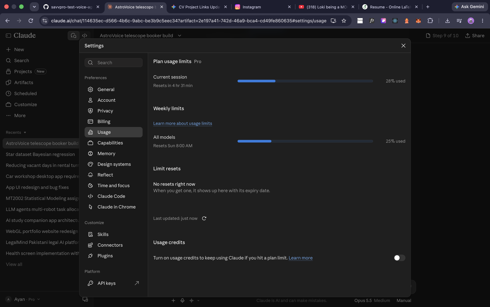

# AI usage

## Tools used

| Tool | Used for |
|---|---|
| **Claude** (claude.ai, model configured as Claude Opus 5.5) working agentically in a cloud workspace | Planning documents (PRD, TRD, App Flow, Backend Schema), writing the code, running tests, building and checking the stack in a browser, writing these docs |
| Claude's web search / fetch | Checking current versions of every dependency and the Deepgram Flux STT/TTS APIs |
| Deepgram (runtime, not development) | Speech-to-text (Flux) and text-to-speech (Flux TTS, Aura-2 fallback) only. It never decides anything. |

**No AI makes decisions at runtime.** The brain (`backend/src/astro_brain`) is plain Python: a state machine,
a rule pipeline, a planner, an interval tree, an undo stack and a min-heap. Claude helped write that code; the
running system calls no language model.

## How it helped

- **Specification first.** Before any code, Claude wrote four planning documents and stress-tested the edge
  cases against the real sky, which caught several wrong assumptions in the brief (below).
- **Version research.** It looked up the current release of every tool (FastAPI 0.162, SQLAlchemy 2.1,
  Postgres 18.6, GoTrue v2.197.0, Next.js 16.4, React 19.3, Tailwind 4.3, Redis 8.10, Caddy 2.11.7, …) and
  pinned them, and checked compatibility limits (spaCy has no Python 3.15 wheels; kombu caps redis-py below
  6.5; typescript-eslint can't load TypeScript 7).
- **Test-driven brain.** Each messy-caller case became a YAML scenario first; the brain was then written until
  all 48 passed, with property tests for the data structures and a cross-process determinism test.
- **Real end-to-end verification.** Without Docker in the sandbox, Claude ran the actual GoTrue and Caddy
  binaries with Postgres, Redis, the API and Next.js, then drove a browser through sign-in, a booking call with
  a change and an undo, the bookings page, settings, and a two-tab user switch (screenshots in
  `docs/screenshots/`).

## Where it went wrong (and how it was caught)

| Problem | How it surfaced | Fix |
|---|---|---|
| The brief's "Saturn below the horizon at 9 PM" isn't true on 27 Oct 2026 | Sky stress test against DE421 | Scenario uses Jupiter (rises 00:44) |
| Assumed the radio dish is cloud-limited | Domain review | It's limited by water vapour (PWV ≤ 4 mm); weather rule and scenarios changed |
| `dateparser` turned "march", "sat", "Saturn on Saturday" into dates | Parser corpus tests | Replaced with a hand-written time grammar |
| Fuzzy matching read "the second one" as TMC-1 | Scenario test | No fuzzy target matching when the caller is picking an offer |
| Planner ranked later nights above a same-night shift | Scenario EC-05 | Ranking key reordered |
| Echo guard ignored a genuine "In the evening" | Scenario test | Minimum length 25 characters for echo detection |
| **Real bug:** other people's bookings (anonymised by the database, so with no id) didn't block a caller who had no hold — `None == None` | API integration test against real Postgres | Explicit "is this my own hold" check; regression scenario EC-54 |
| asyncpg can't run multi-statement migration scripts | First `alembic upgrade` | Migrations run SQL through the raw driver's simple query protocol |
| `DROP TRIGGER` on GoTrue's `auth.users` needs table ownership | Downgrade test | Drop the function with `CASCADE` instead |
| Browser and server derived different Supabase cookie names from different hostnames, so sign-in "didn't stick" | Browser end-to-end run | Fixed cookie name on both sides |
| React 19 form actions cleared the fields after a failed sign-in | Browser end-to-end run | `onSubmit` handlers instead |
| `upgrade-insecure-requests` and `Secure` cookies broke plain-HTTP local runs | Browser end-to-end run | Both follow the public origin's scheme |
| The galaxy canvas was invisible behind the body background | Screenshot review | Background moved to `<html>` |
| A guessed Deepgram voice name (`flux-luna-en`) | Checking the docs before use | Verified `flux-haley-en` from the Flux TTS quickstart |

Smaller slips — lint and type errors, a test expecting 24 catalogue targets when there are 23, and wrong
assertions about which night is clear — were caught by the test suite or the linters on the next run.

## Token usage

- **Plan:** Claude Pro. A screenshot of the usage page after most of the build is in
  [`docs/ai-usage/claude-plan-usage.png`](docs/ai-usage/claude-plan-usage.png): **28 % of the current
  session limit** and **25 % of the weekly all-models limit** used.
- **Recorded transcript (second half of the build, after the conversation was compacted):** about
  **90 million cached input tokens re-read**, **1.1 million tokens written to cache**, **0.51 million output
  tokens** across 313 model turns. Weighted by cost (cache reads ×0.1, cache writes ×2, output ×5), that is
  about **14 million input-token equivalents**:
  - reading and writing files: 37 %
  - the summary of earlier work carried in context: 21 %
  - replies and reasoning: 16 %
  - shell commands (tests, builds, browser checks): 15 %
  - fixed instructions: 9 %
  - web research and the planning doc: about 1 %
- The first half (planning documents, sky stress test and the brain) was summarised when the conversation
  was compacted, so its exact token counts aren't in the transcript. The plan-usage screenshot covers both
  halves.

