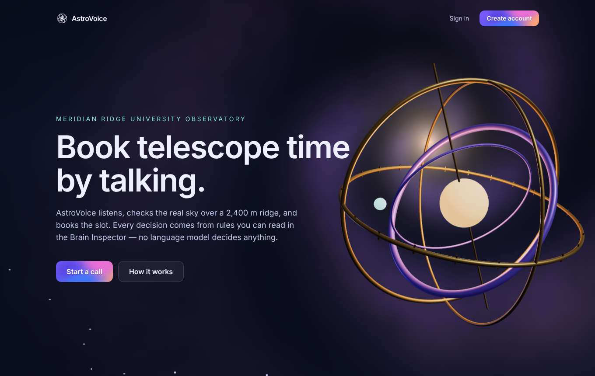
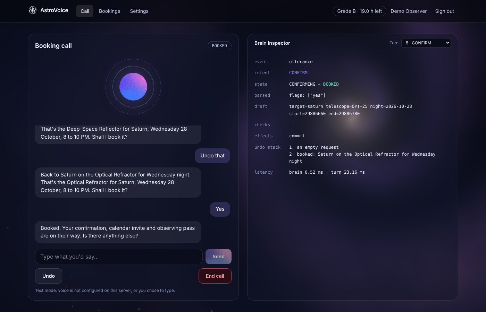

# AstroVoice — University Observatory Telescope Time-Slot Booker

A voice agent that books time on three telescopes at a fictional observatory (Meridian Ridge, 30° N 75° E,
2,400 m, UTC+5). You talk (or type); a **deterministic brain written in Python** — a finite-state machine, a
fixed rule pipeline, an interval tree, a LIFO undo stack and a min-heap waitlist — decides what happens.
No language model makes any decision. Deepgram is used only as ears (Flux STT) and mouth (Flux TTS).

- **Use case and how the brain decides:** [DESIGN.md](DESIGN.md)
- **How AI tools were used:** [AI_USAGE.md](AI_USAGE.md)

## For reviewers: try it live

**Live demo: https://astro.ayandev.app**

1. Create an account with your email (a confirmation link arrives from `bookings@ayandev.app`), use
   **Continue with Google**, or sign in with the demo account `demo@astro.example` (password in the pull
   request description, so no password is committed here).
2. Open **Call** and choose **Start voice call** (allow the microphone; Chrome, Edge, Safari and Firefox work)
   or **Start text call** to type instead. The **Brain Inspector** beside the call shows every decision.
3. Your bookings appear under **Bookings**; preferences (voice, speed, 12/24 h, reduced motion, transcripts,
   sessions, account deletion) under **Settings**.

Good to know:

- **All times are observatory time (UTC+5)**, whatever your own time zone. "Tonight" means the observing night
  that starts this evening at the site; "1 AM" on a night belongs to that night.
- The demo world is planted **relative to the day it was deployed** (day A): A+1 is a cirrus night (optical
  telescopes blocked, the radio dish fine), A+5 is wet (everything blocked), other nights are mostly clear,
  the reflector is already booked tonight 11 PM–1 AM, and the refractor is in maintenance on A+6.
- Health check: https://astro.ayandev.app/api/health/ready (reports whether voice is on).

| | |
|---|---|
|  |  |

## What's in the repo

```
backend/          Python 3.14 — FastAPI API, the brain, Celery worker, Alembic migrations, seed tool, tests
  src/astro_brain   the deterministic brain (pure functions, no I/O)
  src/astro_sky     Skyfield sky precomputation (JPL DE421)
  src/astro_api     REST + WebSocket call loop, Deepgram adapters, RLS database sessions
  src/astro_worker  Celery: outbox email, hold sweep, waitlist promotion, retention
  src/astro_seed    builds the demo world (fake people, real sky, seeded weather)
  migrations/       Alembic (schema, exclusion constraints, triggers, row-level security)
  sql/              first-boot role/schema SQL and per-deploy bootstrap grants
  tests/            brain scenarios (EC-01…EC-54), property tests, RLS tests, API + WebSocket tests
frontend/         Next.js 16 + React 19 + Tailwind 4 + Motion + react-three-fiber
infra/            Caddy, Postgres, Redis, cloudflared config and static error pages
compose*.yaml     base stack + development / staging / production / CI overlays
scripts/secrets.sh  SOPS + age secrets workflow
.github/workflows CI (GitHub-hosted) and deploy (self-hosted runner, guarded)
tools/e2e/        Playwright browser checks (full booking call, cross-tab user isolation)
```

## Run it on your own machine

### Prerequisites

| | macOS | Linux | Windows |
|---|---|---|---|
| Docker + Compose v2 | Docker Desktop, or `brew install colima docker docker-compose` then `colima start --cpu 4 --memory 8` | Docker Engine + compose plugin | Docker Desktop with WSL2; run every command inside the WSL2 shell |
| Also needed | `git`, `openssl` (preinstalled) | `git`, `openssl` | same, inside WSL2 |

About 6 GB of free RAM and 10 GB of disk. The first build downloads images and builds the API and web images
(roughly 5–15 minutes depending on the machine); later starts take seconds.

### Quick start (Docker, development)

```bash
git clone https://github.com/Ayan-Shahid/savvpro-test-voice-agent.git
cd savvpro-test-voice-agent && git switch candidate-Ayan-Shahid
cp .env.example .env                     # non-secret settings (origin, optional Google client id)
scripts/secrets.sh local                 # random development secrets in secrets/runtime/ (git-ignored)
# optional, for voice: printf '%s' 'YOUR_DEEPGRAM_KEY' > secrets/runtime/deepgram_api_key
docker compose -f compose.yaml -f compose.dev.yaml up --build -d
docker compose -f compose.yaml -f compose.dev.yaml --profile seed run --rm seed
curl -s http://localhost:8080/api/health/ready     # {"status":"ok", ...} when everything is up
```

Stop with `docker compose -f compose.yaml -f compose.dev.yaml down`; add `-v` to wipe the database and start
fresh (then run the seed again).

Then open:

| URL | What |
|---|---|
| http://localhost:8080 | the app (landing, sign-up, sign-in, call, bookings, settings) |
| http://localhost:8025 | Mailpit — every email (sign-up confirmations, booking confirmations) lands here |
| http://localhost:8080/api/docs | API docs (development only) |

Sign in as the seeded demo account `demo@astro.example` with the password in
`secrets/runtime/seed_demo_password`, or create an account (the confirmation email appears in Mailpit).
All seeded people are fictional and use the reserved `astro.example` domain.

Without a Deepgram key everything works in **text mode**: start a "text call" and type what you would say.

### Things to try on a call

Night names are relative to the seed day A (see above); pick the weekday that is two days ahead for "A+2".

- "Book the refractor for Saturn on *[A+2 weekday]* from 8 to 10 PM" → "Actually make it the reflector
  instead" → "Undo that" → "Yes" (mid-call change, undo with hold release, confirm)
- "Book the refractor for Jupiter tonight at 9 PM" (below the horizon: the brain offers the real window)
- "What's the weather like tomorrow night?" (the seeded cirrus night)
- "Book the reflector for the Andromeda Galaxy tomorrow from 9 to 11 PM" (cirrus: the dish is offered instead)
- "Book the reflector for Saturn tonight from 11 PM to 1 AM" (already taken: other telescopes, other times, waitlist)
- "Book the reflector for the Orion Nebula on *[A+2 weekday]* at 11 PM" (near full Moon in late October: glare)
- "Book Saturn, no wait, Jupiter…", "the refactor", "make it an hour later", "go back to Saturn", or say
  nothing for a while (self-repair, near-miss clarification, relative edits, named undo, silence handling)
- As the demo account: "Cancel my booking" (it has a seeded radio-dish booking on A+3)

## Google sign-in (optional)

1. In [Google Cloud Console](https://console.cloud.google.com/) → APIs & Services → **OAuth consent screen**:
   External, app name "AstroVoice", your support email, scopes `openid`, `email`, `profile`.
2. **Credentials → Create credentials → OAuth client ID → Web application**.
   - Authorized JavaScript origins: `http://localhost:8080` (and `https://astro.ayandev.app`)
   - Authorized redirect URIs: `http://localhost:8080/auth/v1/callback` (and `https://astro.ayandev.app/auth/v1/callback`)
3. Put the client ID in `.env` (`GOOGLE_ENABLED=true`, `GOOGLE_CLIENT_ID=…`) and the client secret in
   `secrets/runtime/google_client_secret` (development) or via `scripts/secrets.sh edit <env>` (staging/production).
4. `docker compose -f compose.yaml -f compose.dev.yaml up -d gotrue` — a "Continue with Google" button appears
   on the sign-in and sign-up pages (it only shows when GoTrue reports Google as enabled).

The flow is OAuth 2.0 with PKCE through GoTrue; the code is exchanged server-side at `/auth/callback`, and the
redirect after sign-in goes through the same allow-list as every other redirect.

## Troubleshooting

| Symptom | Fix |
|---|---|
| `/api/health/ready` says `"speech":"text-only"` | No Deepgram key: put it in `secrets/runtime/deepgram_api_key` and recreate `api` |
| Sign-in returns to the sign-in page | The web container can't reach GoTrue through `http://caddy:80`; check `docker compose logs caddy gotrue` |
| Confirmation link says "expired" | Links work once and last an hour; request a new one (dev emails are in Mailpit) |
| Microphone does nothing | Browsers allow the mic only on `https://` or `http://localhost`; check the site permission |
| `scripts/secrets.sh` can't decrypt on macOS | `export SOPS_AGE_KEY_FILE=$HOME/.config/sops/age/keys.txt` (sops looks in `~/Library` otherwise) |

## Running the app processes manually (without containers for the app)

Useful for debugging or hot-reloading outside Docker. Postgres, GoTrue, Redis, Mailpit and Caddy still run in
containers (they are infrastructure); the API, worker and web app run directly on your machine.
Requires [uv](https://docs.astral.sh/uv/) and Node.js 22.12+.

```bash
# 1. Infrastructure only (database, auth, cache, mail); Caddy is replaced by the Next dev server's port below
scripts/secrets.sh local && cp -n .env.example .env
docker compose -f compose.yaml -f compose.dev.yaml up -d postgres gotrue redis mailpit db-bootstrap
docker compose -f compose.yaml -f compose.dev.yaml up -d --no-deps caddy   # serves /auth/v1, proxies the rest to your host

# 2. Backend (Python 3.14 via uv)
cd backend
uv sync --extra sky
export ASTRO_ENV=development ASTRO_DB_HOST=localhost ASTRO_DB_PORT=5432 ASTRO_DB_NAME=astrovoice \
       ASTRO_DB_OWNER_PASSWORD="$(cat ../secrets/runtime/db_owner_password)" \
       ASTRO_DB_API_PASSWORD="$(cat ../secrets/runtime/db_api_password)" \
       ASTRO_DB_WORKER_PASSWORD="$(cat ../secrets/runtime/db_worker_password)" \
       ASTRO_JWT_SECRET="$(cat ../secrets/runtime/jwt_secret)" ASTRO_JWT_ISSUER=http://localhost:8080/auth/v1 \
       ASTRO_GOTRUE_URL=http://localhost:8080/auth/v1 ASTRO_PUBLIC_ORIGIN=http://localhost:8080 \
       ASTRO_REDIS_URL=redis://astro-api@localhost:6379/0 \
       ASTRO_REDIS_PASSWORD="$(cat ../secrets/runtime/redis_api_password)"
uv run alembic upgrade head
docker compose -f ../compose.yaml -f ../compose.dev.yaml --profile seed run --rm --no-deps seed   # demo users via GoTrue's admin API
uv run uvicorn astro_api.main:app --factory --reload --port 8000 &
# worker (another terminal, same exports but the worker's DB/Redis credentials):
#   ASTRO_REDIS_URL=redis://astro-worker@localhost:6379/1 ASTRO_REDIS_PASSWORD_SECRET=redis_worker_password \
#   uv run celery -A astro_worker.tasks worker -B --loglevel INFO

# 3. Frontend
cd ../frontend && npm ci
PUBLIC_ORIGIN=http://localhost:8080 INTERNAL_ORIGIN=http://localhost:8080 npm run dev
```

In this mode Caddy must forward `/api`, `/ws` and pages to your host instead of to containers: edit
`infra/caddy/Caddyfile` so `api:8000` and `web:3000` read `host.docker.internal:8000` and
`host.docker.internal:3000` (Docker Desktop and Colima both provide that name). The Docker quick start above
is the supported path; this one is for working on the code.

## Tests

```bash
cd backend
uv run pytest tests/brain                       # the brain: 48 scripted calls + property + determinism tests
ASTRO_TEST_PG=postgresql://postgres@localhost:5432/postgres \
ASTRO_TEST_REDIS=redis://localhost:6379/5 uv run pytest   # + migrations, RLS, API, WebSocket, worker (179 tests)
uv run ruff check src tests migrations && uv run mypy

cd frontend && npm run lint && npm run typecheck && npm test && npm run build
BASE_URL=http://localhost:8080 node tools/e2e/e2e.cjs /tmp   # browser: sign in, call, book, inspect
```

The database tests create a throwaway database and build it exactly like a deploy does (roles, schemas,
GoTrue's `auth` tables, bootstrap grants, `alembic upgrade head`), then act as anonymous, two users, the
worker and an admin to prove what each can read and change.

## Environments

| | Images | Email | Ingress | Seed |
|---|---|---|---|---|
| development (`compose.dev.yaml`) | `dev` targets, hot reload | Mailpit | `localhost:8080` | full demo |
| staging (`compose.staging.yaml`) | `prod` targets | Resend SMTP relay on ayandev.app | Cloudflare tunnel | full demo, re-planted on every deploy (A = deploy day) |
| production (`compose.prod.yaml`) | `prod` targets, read-only, resource limits | Resend SMTP relay | Cloudflare tunnel | catalogue only |
| CI (`compose.ci.yaml`) | `test` target | — | — | per test |

## Secrets

Secrets never enter git in plaintext and never sit in environment variables. `secrets/<env>.enc.yaml` is
encrypted with SOPS + age (`.sops.yaml` lists the recipients). On deploy, `scripts/secrets.sh render <env>`
decrypts them into `secrets/runtime/` (0600, git-ignored), Compose mounts them as Docker secrets at
`/run/secrets`, and the deploy job shreds them afterwards. CI runs gitleaks on every push.

```bash
scripts/secrets.sh init staging    # generate strong random values, encrypted
scripts/secrets.sh edit staging    # add deepgram_api_key, smtp_password (Resend), cloudflared_token
```

## Deployment

`.github/workflows/ci.yml` lints, type-checks and tests everything on GitHub-hosted runners for every PR.
`.github/workflows/deploy.yml` runs on a self-hosted runner (a Mac under Colima) only for pushes to `main`
in the repository named by the `DEPLOY_OWNER` variable, so forks and pull requests can never reach it. It
renders secrets, builds images, runs migrations, rolls out with health checks, smoke-tests
`/api/health/ready` and wipes the rendered secrets. The public hostname (`astro.ayandev.app`) comes in
through a Cloudflare tunnel, so the host opens no inbound ports.
